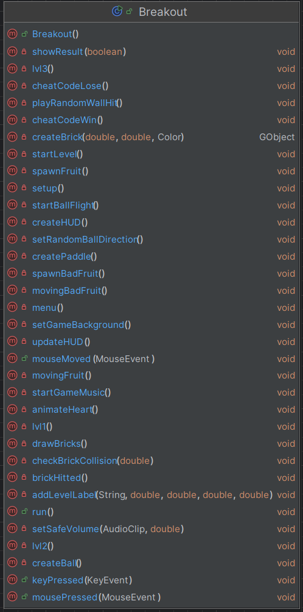
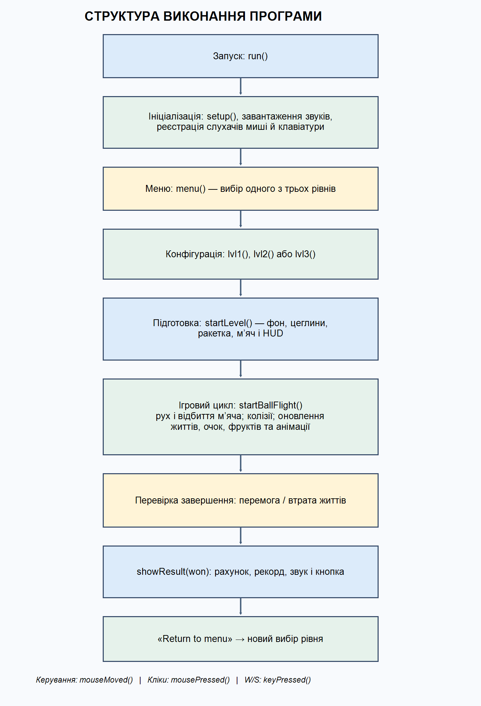
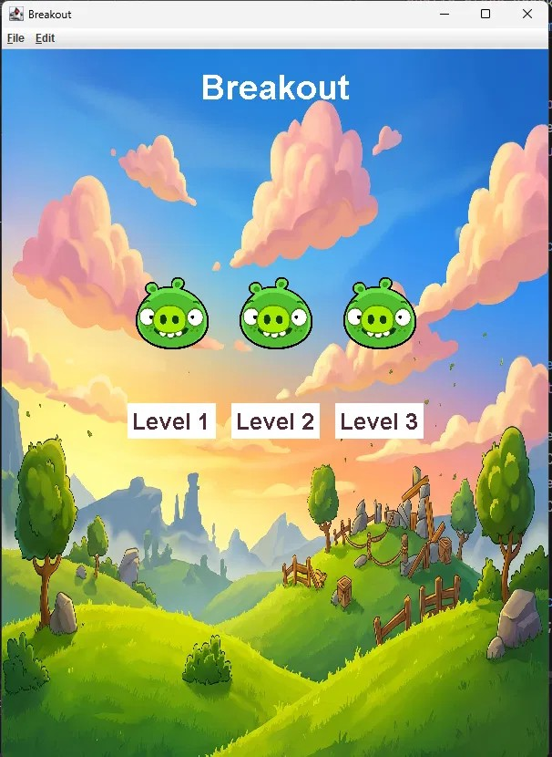
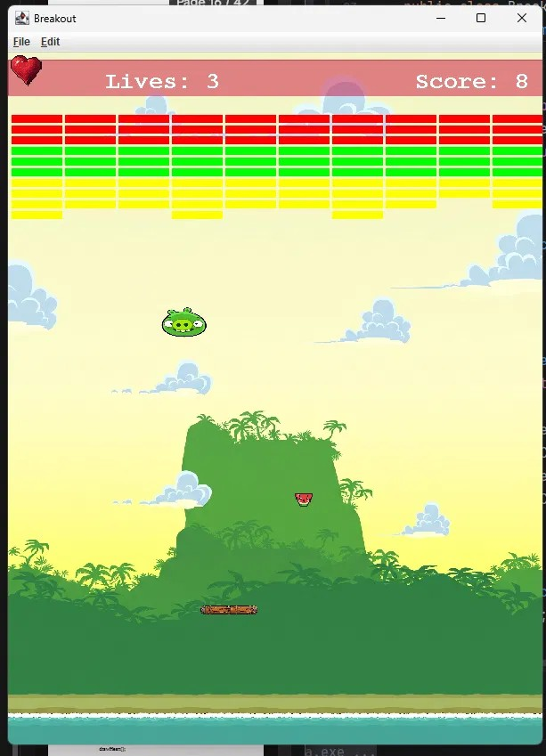
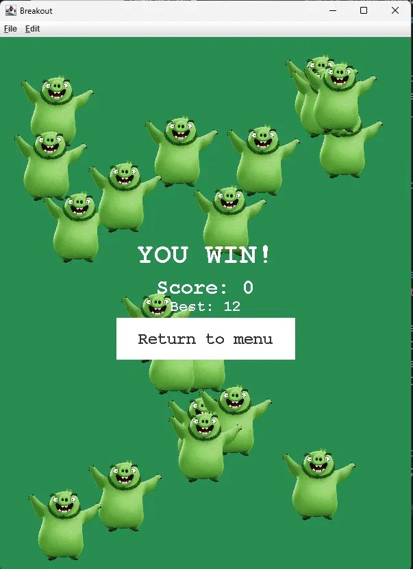
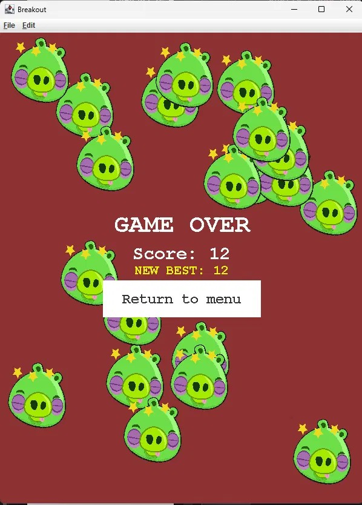

<div align="center">

REQUIRES JAVA VERSION 1.8

МІНІСТЕРСТВО ОСВІТИ І НАУКИ УКРАЇНИ

НАЦІОНАЛЬНИЙ УНІВЕРСИТЕТ «КИЄВО-МОГИЛЯНСЬКА АКАДЕМІЯ»

ФАКУЛЬТЕТ ІНФОРМАТИКИ

СПЕЦІАЛЬНІСТЬ F2 «ІНЖЕНЕРІЯ ПРОГРАМНОГО ЗАБЕЗПЕЧЕННЯ»

<p align="center"></p>

**ЗВІТ**

з лабораторної роботи № 2

з дисципліни «Вступ до програмування»

**«Breakout»**

Виконали:

Студенти 1 курсу, групи 5

Ступко Давид

Туяхов Кирило

Викладач:

Пєчкурова Олена

Київ – 2026

</div>

---

# ЗМІСТ

1. [Постановка задачі](#1-постановка-задачі)
2. [Розподіл задач](#2-розподіл-задач)
3. [Структура програми: UML-діаграма та ієрархія виконання](#3-структура-програми)
4. [Опис методів та класів](#4-опис-методів-та-класів)
5. [Інструкція користувача зі скріншотами працюючої гри](#5-інструкція-користувача-зі-скріншотами-працюючої-гри)
6. [Проблеми, які виникали, та шляхи їх вирішення](#6-проблеми-які-виникали-та-шляхи-їх-вирішення)
7. [Висновки](#7-висновки)
8. [Програмний код (повний текст Breakout.java)](#8-програмний-код)

# 1. ПОСТАНОВКА ЗАДАЧІ

Метою лабораторної роботи було створити мовою Java аркадну гру Breakout на основі бібліотеки ACM. М’яч рухається в межах вікна, відбивається від стін і ракетки та руйнує цеглини у верхній частині ігрового поля. Гравець керує ракеткою мишею, не допускає падіння м’яча за нижню межу й намагається очистити поле від усіх цеглин.

Розроблена версія розширює базове завдання: містить меню з трьома рівнями складності, звукове супроводження, очки й рекорд, бонусні та негативні фрукти, міцні цеглини, HUD із лічильником життів і екрани перемоги/поразки. Після завершення партії користувач може повернутися до меню.

Розмір ігрового вікна — 600 × 800 пікселів; поле складається зі 100 цеглин (10 × 10). Перемога настає після руйнування всіх цеглин, поразка — після втрати останнього життя. Початковий напрямок м’яча вибирається випадково, а його швидкість задають компоненти vx і vy.

Проєкт написано в IntelliJ IDEA мовою Java із використанням ACM Graphics/Program/Util та ресурсів із каталогів Images і Music. Розробка виконувалася спільно двома студентами із використанням GitHub.

## Рівні складності

Рівень 1: три життя, швидкість м’яча 5; міцних цеглин і негативних фруктів немає, позитивні бонуси ввімкнені. Рівень 2: два життя, швидкість 7; є міцні цеглини й позитивні/негативні фрукти. Рівень 3: одне життя, швидкість 9; увімкнено ті самі складні елементи, що й на рівні 2.

Позитивні фрукти дають додаткове життя, збільшують ширину ракетки або додають 5 очок. Негативні забирають життя, зменшують ракетку або віднімають 5 очок (рахунок не опускається нижче нуля). За очки гравець отримує додаткове життя після перетину чергового порогу 50 очок.

# 2. РОЗПОДІЛ ЗАДАЧ

## Ступко Давид

> 1\. Початок проєкту: acm.jar, константи, зображення.
>
> 2\. Аудіо: музика меню/гри, звуки зіткнень, знищення цеглин, перемоги й поразки; інтеграція у гру.
>
> 3\. Меню: відображення та вибір рівня.
>
> 4\. Фізика м’яча та колізії з цеглинами: startBallFlight(), випадковий напрямок, відбиття від стін, ракетки й цеглин.
>
> 5\. Результати: екрани перемоги/поразки, рахунок, рекорд і кнопка «Return to menu».

## Туяхов Кирило

> 1\. Ініціалізація: слухачі миші, setup(), фон.
>
> 2\. Цеглини: сітка GRect, три кольори, міцні сірі блоки рівнів 2–3.
>
> 3\. Ракетка: створення, розмір і рух за мишею.
>
> 4\. HUD: життя, бали, анімація серця.
>
> 5\. Бонуси та рахунок: позитивні/негативні фрукти, бали, додаткове життя за 50 очок, рекорд.
>
> 6\. М’яч і тестування: створення/початкове розміщення; чіт-коди W (виграш) та S (програш).

# 3. СТРУКТУРА ПРОГРАМИ

Програма складається з одного основного класу Breakout, який успадковує GraphicsProgram із бібліотеки ACM. Окремих власних класів моделі/контролера гра не має: стан гри, графічні об’єкти, обробники подій і логіка містяться у Breakout.java. GImage, GRect, GLabel і GObject використовуються для графіки; RandomGenerator — для випадкових значень; MediaTools, AudioClip і SoundClip — для аудіо.

На рисунку 1 показано UML-зв’язки класу Breakout із базовим класом та бібліотечними компонентами. Рисунок 2 відображає основний сценарій виконання програми від запуску до повернення в меню.

<p align="center"></p>

<p align="center"><em>Рисунок 1 — UML-діаграма</em></p>

<p align="center"></p>

<p align="center"><em>Рисунок 2 — Ієрархія основного сценарію гри</em></p>

## Групи даних класу

Константи задають розміри вікна, ракетки, м’яча й цеглин, кількість рядів/стовпців, проміжки між цеглинами, початкові життя та параметри фруктів. Поля стану зберігають вибраний рівень, прапорці меню й завершення, кількість життів, очки, рекорд, швидкість і компоненти руху м’яча. Графічні поля посилаються на ракетку, м’яч, цеглини, фон, фрукти, HUD і кнопку результату. Звукові поля містять музичні кліпи та ефекти.

## Основний цикл роботи

run() налаштовує програму, завантажує звуки й реєструє слухачів. Далі метод циклічно показує меню, очікує вибір рівня та запускає його. Метод рівня встановлює параметри складності й викликає startLevel(). Після підготовки поля startBallFlight() оновлює стан гри з короткою паузою між кадрами. Коли кількість життів стає нульовою, цикл завершується, а showResult(won) показує фінальний екран. Клік по кнопці повертає виконання до нового циклу меню.

UML-діаграма відображає один власний клас відповідно до фактичної організації вихідного коду. ACM та стандартні класи Java показані як залежності, а не класи, створені авторами проєкту.

# 4. ОПИС МЕТОДІВ ТА КЛАСІВ

## 4.1. Клас Breakout

Breakout extends GraphicsProgram — головний клас гри. Він задає параметри поля, створює візуальні елементи, керує життями та рахунком, обробляє події миші й клавіатури, рухає м’яч і відтворює звук. Використані зовнішні класи: acm.graphics.GImage/GRect/GLabel/GObject, acm.program.GraphicsProgram, acm.util.RandomGenerator/MediaTools/SoundClip, java.applet.AudioClip та AWT Color, Font, MouseEvent, KeyEvent.

## 4.2. Методи класу

| **Метод**                        | **Призначення**                                                                                                                                         |
|----------------------------------|---------------------------------------------------------------------------------------------------------------------------------------------------------|
| `run()` | Ініціалізує гру, завантажує звуки, реєструє слухачів; циклічно відкриває меню, очікує рівень і запускає відповідний сценарій.                           |
| `lvl1()` | Задає 3 життя, швидкість 5, вимикає міцні блоки й негативні фрукти; викликає startLevel().                                                              |
| `lvl2()` | Задає 2 життя, швидкість 7, вмикає міцні блоки та обидва типи фруктів.                                                                                  |
| `lvl3()` | Задає 1 життя, швидкість 9, вмикає міцні блоки та обидва типи фруктів.                                                                                  |
| `startLevel()` | Запускає музику, очищає сцену, скидає стан рівня, створює фон, цеглини, ракетку, м’яч і HUD, запускає цикл та показ результату.                         |
| `createHUD()` | Створює панель, іконку серця й написи життів/рахунку; викликає updateHUD().                                                                             |
| `updateHUD()` | Оновлює текст життів і рахунку та розташування написів.                                                                                                 |
| `animateHeart()` | Змінює розмір і позицію серця для короткої анімації після зміни життів.                                                                                 |
| `spawnFruit()` | Випадково створює позитивний фрукт над знищеною цеглиною та задає затримку перевірки зіткнення.                                                         |
| `movingFruit()` | Рухає фрукт униз; зіткнення з м’ячем дає життя, збільшує ракетку або додає очки; фрукт видаляється після збору чи виходу за межі.                       |
| `spawnBadFruit()` | З певною ймовірністю створює негативний фрукт, якщо режим увімкнений.                                                                                   |
| `movingBadFruit()` | Рухає негативний фрукт; зіткнення віднімає життя, зменшує ракетку або очки; рахунок обмежений знизу нулем.                                              |
| `cheatCodeWin()` | Встановлює стан перемоги й завершує ігровий цикл; викликається клавішею W.                                                                              |
| `keyPressed(KeyEvent)` | Обробляє клавіатурні команди поза меню та екраном результату: W — виграш, S — програш.                                                                  |
| `cheatCodeLose()` | Встановлює стан поразки й завершує цикл; викликається клавішею S.                                                                                       |
| `brickHitted()` | Нараховує очко, видає життя після перетину порогу 50 очок, рахує зруйновані цеглини й перевіряє перемогу.                                               |
| `startGameMusic()` | Зупиняє музику меню та циклічно відтворює музику гри.                                                                                                   |
| `menu()` | Показує фон, заголовок і три доступні рівні; запускає музику меню.                                                                                      |
| `setSafeVolume(AudioClip,double)` | Задає гучність лише для аудіокліпів типу SoundClip.                                                                                                     |
| `playRandomWallHit()` | Випадково обирає один із трьох звуків відбиття.                                                                                                         |
| `addLevelLabel(...)` | Створює оформлену кнопку-підпис рівня та центрує текст.                                                                                                 |
| `setup()` | Виконує початкове налаштування: створює фон і задає стартові значення.                                                                                  |
| `setGameBackground()` | Завантажує та масштабує фонове зображення ігрового поля.                                                                                                |
| `drawBricks()` | Створює сітку 10 × 10, кольори рядів і на рівнях 2–3 випадково позначає міцні сірі цеглини.                                                             |
| `createBrick(double,double,Color)` | Створює заповнений графічний прямокутник цеглини з позицією та кольором.                                                                                |
| `createBall()` | Створює зображення м’яча, розміщує його біля центру та задає початкові vx/vy з випадкового кута.                                                        |
| `startBallFlight()` | Основний ігровий цикл: рух м’яча, оброблення стін і ракетки, фруктів, цеглин, втрати життя й анімації HUD.                                              |
| `setRandomBallDirection()` | Вибирає новий випадковий напрямок після втрати життя зі швидкістю рівня.                                                                                |
| `checkBrickCollision(double)` | Шукає зіткнення з цеглинами; міцну сіру цеглину переводить у світло-сірий стан після першого удару, звичайну руйнує, нараховує очки та змінює напрямок. |
| `showResult(boolean)` | Формує екран перемоги/поразки з очками й рекордом, відтворює звук та чекає кліку повернення.                                                            |
| `createPaddle()` | Створює ракетку, задає розмір і розташування біля нижньої межі.                                                                                         |
| `mouseMoved(MouseEvent)` | Рухає ракетку за координатою курсора, обмежуючи її межами вікна.                                                                                        |
| `mousePressed(MouseEvent)` | Повертає до меню з екрана результату або вибирає один із рівнів.                                                                                        |

# 5. ІНСТРУКЦІЯ КОРИСТУВАЧА ЗІ СКРІНШОТАМИ ПРАЦЮЮЧОЇ ГРИ

Для запуску потрібні Java, бібліотека ACM (acm.jar) та каталоги Images і Music у робочій директорії. В IntelliJ IDEA відкрийте проєкт і запустіть клас Breakout як GraphicsProgram.

## Крок 1. Вибір рівня

Після запуску з’являється меню. Натисніть мишею Level 1, Level 2 або Level 3. Складність підвищується зі швидкістю м’яча та міцними блоками, а кількість початкових життів зменшується.

<p align="center"></p>

<p align="center"><em>Рисунок 3 — Початкове меню з вибором рівня</em></p>

## Крок 2. Керування грою

Переміщуйте курсор ліворуч або праворуч, щоб рухати ракетку. М’яч запускається автоматично. Відбивайте його, не допускаючи падіння за нижню межу. У верхній панелі відображено життя й рахунок. Сірі цеглини рівнів 2–3 руйнуються після другого удару.

<p align="center"></p>

<p align="center"><em>Рисунок 4 — Ігрове поле, HUD, м’яч і фрукт-бонус</em></p>

## Крок 3. Бонуси

Після знищення цеглин можуть з’являтися фрукти, що рухаються вниз. Для отримання ефекту торкніться фрукту м’ячем: позитивні фрукти дають бонус, негативні — штраф. На рівні 1 негативні фрукти вимкнені.

## Крок 4. Завершення гри

Перемога настає після руйнування всіх цеглин, поразка — після втрати останнього життя. Фінальний екран показує поточний рахунок і рекорд. Рекорд зберігається під час поточного запуску програми. Щоб грати знову, натисніть «Return to menu».

<p align="center"></p>

<p align="center"><em>Рисунок 5 — Екран перемоги з результатом і кнопкою повернення</em></p>

<p align="center"></p>

<p align="center"><em>Рисунок 6 — Екран поразки з рахунком і кнопкою повернення</em></p>

# 6. ПРОБЛЕМИ, ЯКІ ВИНИКАЛИ, ТА ШЛЯХИ ЇХ ВИРІШЕННЯ

**«Прилипання» м’яча до ракетки.** Для перевірки зіткнення використовується попередня координата previousY: відбиття спрацьовує лише коли м’яч рухається вниз і перетнув рівень ракетки за кадр. Після контакту м’яч розміщується над ракеткою, а швидкість перераховується відповідно до точки удару.

**Очки нараховувалися на початку рівня.** Підготовку сцени відокремлено від оброблення реального зіткнення: очки й кількість зруйнованих блоків оновлюються лише під час руйнування цеглини.

**Міцні цеглини руйнувалися з першого удару.** Для них реалізовано два стани: після першого зіткнення колір змінюється із сірого на світло-сірий, цеглина видаляється після наступного удару.

**М’яч одразу підбирав створений фрукт.** Додано лічильник затримки, упродовж якого фрукт уже рухається, але перевірка зіткнення з м’ячем ще не виконується.

**Великі аудіофайли.** Аудіоматеріали перетворено з MP3 у WAV для використання в проєкті; загальний розмір зменшено приблизно з 28 МБ до 7 МБ.

Під час налагодження перевірялися зіткнення зі стінами, ракеткою та цеглинами; перезапуск м’яча після втрати життя; перехід до екранів результатів і повернення в меню; ефекти фруктів і міцних цеглин.

# 7. ВИСНОВКИ

Створено гру Breakout із трьома рівнями складності, керуванням ракеткою мишею, фізикою руху м’яча, звичайними й міцними блоками, системою очок і життів, бонусами, музикою та звуковими ефектами. Реалізовано меню, HUD, екрани результатів і повернення до меню. Спільна робота в IntelliJ IDEA та GitHub дала змогу розподілити незалежні частини програми й об’єднати їх у робочий проєкт.

# 8. ПРОГРАМНИЙ КОД

Нижче наведено повний вихідний код класу Breakout.java, використаний у проєкті.

```java
/*
 * File: Breakout.java
 * -------------------
 * Name:
 * Section Leader:
 *
 * This file will eventually implement the game of Breakout.
 */

import acm.graphics.*;
import acm.program.GraphicsProgram;
import acm.util.MediaTools;
import acm.util.RandomGenerator;
import acm.util.SoundClip;

import java.applet.AudioClip;
import java.awt.Color;
import java.awt.Font;
import java.awt.event.KeyEvent;
import java.awt.event.MouseEvent;


public class Breakout extends GraphicsProgram {


	/** Width and height of application window in pixels */
	public static final int APPLICATION_WIDTH = 600;
	public static final int APPLICATION_HEIGHT = 800;

	/** Dimensions of game board (usually the same) */
	private static int WIDTH = APPLICATION_WIDTH;
	private static int HEIGHT = APPLICATION_HEIGHT;

	/** Dimensions of the paddle */
	private static final int PADDLE_WIDTH = 60;
	private static final int PADDLE_HEIGHT = 10;

	/** Offset of the paddle up from the bottom */
	private static final int PADDLE_Y_OFFSET = 150;

	/** Number of bricks per row */
	private static final int NBRICKS_PER_ROW = 10;

	/** Number of rows of bricks */
	private static final int NBRICK_ROWS = 10;

	/** Separation between bricks */
	private static final int BRICK_SEP = 4;

	/** Width of a brick */
	private static final int BRICK_WIDTH =
			(WIDTH - (NBRICKS_PER_ROW - 1) * BRICK_SEP) / NBRICKS_PER_ROW;

	/** Height of a brick */
	private static final int BRICK_HEIGHT = 8;

	/** Radius of the ball in pixels */
	private static final int BALL_RADIUS = 15;

	/** Offset of the top brick row from the top */
	private static final int BRICK_Y_OFFSET = 70;

	/** Number of turns */
	private static final int NTURNS = 3;

	private static final double HEART_SIZE = 40;

	private static final Color BACKGROUND = Color.CYAN;
	private final RandomGenerator random = RandomGenerator.getInstance();

	//ui
	private GImage paddle;
	private GImage ball;
	private GRect brick;
	private GImage Menu;
	private GImage gameBackground;
	private GImage levelOneIcon;
	private GImage levelTwoIcon;
	private GImage levelThreeIcon;
	private GImage fruit;
	private GRect selectedLevelBorder;

	private int selectedLevel;
	private boolean menuActive;
	private volatile boolean levelChosen;

	private GImage heartIcon;
	private GLabel livesLabel;
	private GLabel pointsLabel;
	private GRect resultButton;
	private GLabel resultButtonLabel;
	private boolean showingResult;
	private boolean returnToMenuChosen;
	private boolean won;
	private int destroyedBricks;
	private static final int HUD = HEIGHT - (HEIGHT-(HEIGHT/100));
	private int bestScore;
	private GImage badFruit;

	//sounds
	private AudioClip ballSound;
	private AudioClip brickSound;
	private AudioClip brickSound2;
	private AudioClip brickSound3;
	private AudioClip musicInMenu;
	private AudioClip musicInGame;
	private AudioClip WallHit1;
	private AudioClip WallHit2;
	private AudioClip WallHit3;
	private AudioClip brickDestroyed;
	private AudioClip winSound;
	private AudioClip loseSound;

	//game logic
	private int lives;
	private double vx,vy;
	private int points;
	private double ballSpeed;
	private boolean strongBricks;
	private boolean bonuses;
	private int heartAnimationFrames;
	private double heartX,heartY;
	private static final double FRUIT_SIZE=20;
	private static final double FRUIT_SPEED=1;
	private int FRUITSPAWN_DELAY;
    private int bonusType;
	private int freeLife=50;
	private boolean badBonuses;
	private int badfruitdelay;
	private int badBonusType;


	/** Initializes the game and runs the level-selection loop. */
	public void run() {
		setup();
		musicInMenu = MediaTools.loadAudioClip("Music/menuMusic.wav");
		setSafeVolume(musicInMenu, 0.05);
		musicInGame = MediaTools.loadAudioClip("Music/gameMusic.wav");
		setSafeVolume(musicInGame, 0.15);
		WallHit1 = MediaTools.loadAudioClip("Music/WallHit1.wav");
		setSafeVolume(WallHit1, 0.5);
		WallHit2 = MediaTools.loadAudioClip("Music/WallHit2.wav");
		setSafeVolume(WallHit2, 0.5);
		WallHit3 = MediaTools.loadAudioClip("Music/WallHit3.wav");
		setSafeVolume(WallHit3, 0.5);
		brickDestroyed = MediaTools.loadAudioClip("Music/brickDestroyed.wav");
		setSafeVolume(brickDestroyed, 0.5);
		winSound = MediaTools.loadAudioClip("Music/winSound.wav");
		setSafeVolume(winSound, 0.5);
		loseSound = MediaTools.loadAudioClip("Music/loseSound.wav");
		setSafeVolume(loseSound, 0.5);
		addMouseListeners();
		addKeyListeners();

		while (true) {
			levelChosen = false;
			removeAll();
			menu();

			while (!levelChosen) {
				pause(50);
			}

			if (selectedLevel == 1) {
				lvl1();
			} else if (selectedLevel == 2) {
				lvl2();
			} else if (selectedLevel == 3) {
				lvl3();
			}
		}
	}

	/** Configures and starts the hardest level. */
	private void lvl3() {
		lives = 1;
		ballSpeed=9;
		strongBricks=true;
		bonuses=true;
		badBonuses = true;
		startLevel();
	}

	/** Configures and starts the medium level. */
	private void lvl2() {
		lives = 2;
		ballSpeed = 7;
		strongBricks = true;
		bonuses=true;
		badBonuses=true;
		startLevel();
	}

	/** Configures and starts the easiest level. */
	private void lvl1() {
		lives = 3;
		ballSpeed = 5;
		strongBricks = false;
		bonuses=true;
		badBonuses = false;
		startLevel();
	}

	/** Resets the scene and starts a new level. */
	private void startLevel(){
		startGameMusic();
		removeAll();
		fruit=null;
		badFruit=null;
		setGameBackground();
		drawBricks();
		createPaddle();
		createBall();
		points = 0;
		destroyedBricks = 0;
		won = false;
		createHUD();
		startBallFlight();
		showResult(won);
	}

    /** Creates the heads-up display. */
    private void createHUD() {
		double hudHeight = (double)HEIGHT/20;
		GRect hud = new GRect(0,HUD,WIDTH,hudHeight);
		hud.setFilled(true);
		hud.setColor(new Color(200,0,50,120));
		add(hud);

		heartIcon = new GImage("Images/heart.png");
		double xHeart = WIDTH/10;
		heartIcon.setSize(HEART_SIZE,HEART_SIZE);
		add(heartIcon,xHeart,HUD);

		livesLabel = new GLabel("");
		livesLabel.setFont(new Font("MonoSpaced",Font.BOLD,26));
		livesLabel.setColor(Color.WHITE);
		add(livesLabel,xHeart+HEART_SIZE+10,0);

		pointsLabel = new GLabel("");
		pointsLabel.setFont(new Font("Monospaced",Font.BOLD,26));
		pointsLabel.setColor(Color.WHITE);
		add(pointsLabel);

		updateHUD();
    }

    /** Refreshes the lives and score labels. */
    private void updateHUD() {
        if(livesLabel==null) return;
		double hudHeight = HEIGHT/20;
		double textY = HUD +(hudHeight+livesLabel.getAscent())/2-2;

		livesLabel.setLabel("Lives: "+lives);
		livesLabel.setLocation(livesLabel.getX(),textY);

		pointsLabel.setLabel("Score: "+points);
		pointsLabel.setLocation(WIDTH-pointsLabel.getWidth()-15,textY);

    }

	/** Animates the heart icon after a life change. */
	private void animateHeart(){
		if(heartAnimationFrames<=0) return;
		heartAnimationFrames--;
		double scale = 1+0.3*Math.sin(Math.PI*heartAnimationFrames/30);
		double size = HEART_SIZE*scale;
		heartIcon.setSize(size,size);
		heartIcon.setLocation(heartX-(size-HEART_SIZE)/2,heartY-(size-HEART_SIZE)/2);
	}


	/** Spawns a random positive bonus fruit. */
	private void spawnFruit(){
		if(!bonuses || fruit !=null) return;
		if(!random.nextBoolean(0.5)) return;

		int whichFruit = random.nextInt(1,3);
		bonusType = whichFruit;
		if(whichFruit==1){
			fruit = new GImage("Images/apple.png");
		}else if(whichFruit==2){
			fruit=new GImage("Images/banana.png");
		}else{
			fruit = new GImage("Images/watermelon.png");
		}
		fruit.setSize(FRUIT_SIZE,FRUIT_SIZE);
		double x = brick.getX()+(brick.getWidth()- FRUIT_SIZE)/2;
		add(fruit,x,brick.getY());
		FRUITSPAWN_DELAY=50;
	}

	/** Moves a bonus fruit and applies its effect. */
	private void movingFruit(){
		if (fruit==null || won ) return;

		fruit.move(0,FRUIT_SPEED);

		if(FRUITSPAWN_DELAY>0){
			FRUITSPAWN_DELAY--;
			return;
		}

		boolean hit = ball.getX() + ball.getWidth() > fruit.getX()
				&& ball.getX() < fruit.getX() + fruit.getWidth()
				&& ball.getY() + ball.getHeight() > fruit.getY()
				&& ball.getY() < fruit.getY() + fruit.getHeight();
		if(hit){
            if(bonusType==1){
				lives++;
				updateHUD();
				heartAnimationFrames=30;
				remove(fruit);
				fruit=null;
			}else if(bonusType==2){
				double newWidth = Math.min(paddle.getWidth() * 1.3, 200);
				paddle.setSize(newWidth, paddle.getHeight());
				remove(fruit);
				fruit=null;
			}else{
				points+=5;
				updateHUD();
				remove(fruit);
				fruit=null;
			}

		}else if(fruit.getY()>getHeight()){
			remove(fruit);
			fruit=null;
		}
	}

	/** Spawns a random negative fruit when enabled. */
	private void spawnBadFruit(){
		if(!badBonuses || badFruit != null) return;
		if(!random.nextBoolean(0.3)) return;

		int whichBadFruit = random.nextInt(1,3);
		badBonusType = whichBadFruit;
		if(whichBadFruit==1){
			badFruit = new GImage("Images/gadskiy_apple.png");
		}else if(whichBadFruit==2){
			badFruit = new GImage("Images/gadskiy_banana.png");
		}else{
			badFruit = new GImage("Images/gadskiy_watermelon.png");
		}
		badFruit.setSize(FRUIT_SIZE,FRUIT_SIZE);
		double x = brick.getX()+(brick.getWidth()- FRUIT_SIZE)/2;
		add(badFruit,x,brick.getY());
		badfruitdelay=50;
	}

	/** Moves a negative fruit and applies its penalty. */
	private void movingBadFruit(){
		if (badFruit==null || won ) return;

		badFruit.move(0,FRUIT_SPEED);

		if(badfruitdelay>0){
			badfruitdelay--;
			return;
		}

		boolean hit = ball.getX() + ball.getWidth() > badFruit.getX()
				&& ball.getX() < badFruit.getX() + badFruit.getWidth()
				&& ball.getY() + ball.getHeight() > badFruit.getY()
				&& ball.getY() < badFruit.getY() + badFruit.getHeight();
		if(hit){
			if(badBonusType==1){
				lives--;
				updateHUD();
				heartAnimationFrames=30;
				remove(badFruit);
				badFruit=null;
			}else if(badBonusType==2){
				double newWidth = Math.max(paddle.getWidth() * 0.7, 40);
				paddle.setSize(newWidth, paddle.getHeight());
				remove(badFruit);
				badFruit=null;
			}else{
				points-=5;
				if(points<0){
					points=0;
				}
				updateHUD();
				remove(badFruit);
				badFruit=null;
			}

		}else if(badFruit.getY()>getHeight()){
			remove(badFruit);
			badFruit=null;
		}
	}

	/** Ends the current level with a win. */
	private void cheatCodeWin(){
		won=true;
		lives=0;
	}

	/** Handles the W and S test shortcuts. */
	public void keyPressed(KeyEvent e){
		if(menuActive || showingResult) return;

		if(e.getKeyCode()==KeyEvent.VK_W){
			cheatCodeWin();
		}else if(e.getKeyCode()==KeyEvent.VK_S){
			cheatCodeLose();
		}
	}

	/** Ends the current level with a loss. */
	private void cheatCodeLose(){
		won=false;
		lives=0;
	}

    /** Awards points and checks whether all bricks are cleared. */
    private void brickHitted() {
		points++;

        if(points>freeLife){
			lives++;
			freeLife+=50;
			heartAnimationFrames=30;
		}

		updateHUD();
		destroyedBricks++;
		if (destroyedBricks >= NBRICK_ROWS * NBRICKS_PER_ROW) {
			won = true;
			lives = 0;
		}
    }

    /** Switches playback from menu music to game music. */
    private void startGameMusic() {
		menuActive = false;
		musicInMenu.stop();
		musicInGame.stop();
		musicInGame.loop();
	}

	/** Displays the level-selection menu. */
	private void menu() {
		menuActive = true;
		musicInGame.stop();
		musicInMenu.stop();
		musicInMenu.loop();

		Menu = new GImage("Images/menu.png");
		Menu.setSize(WIDTH, HEIGHT);
		add(Menu);

		GLabel title = new GLabel("Breakout");
		title.setFont(new Font("Arial", Font.BOLD, 38));
		title.setColor(Color.WHITE);
		add(title, (WIDTH - title.getWidth()) / 2, 55);

		double iconWidth = 96;
		double iconHeight = 144;
		double gap = 18;
		double rowWidth = iconWidth * 3 + gap * 2;
		double startX = (WIDTH - rowWidth) / 2;
		double iconY = 220;

		levelOneIcon = new GImage("Images/pig.png");
		levelOneIcon.setSize(iconWidth, iconHeight);
		add(levelOneIcon, startX, iconY);
		addLevelLabel("Level 1", startX, iconY, iconWidth, iconHeight);

		levelTwoIcon = new GImage("Images/pig.png");
		levelTwoIcon.setSize(iconWidth, iconHeight);
		add(levelTwoIcon, startX + iconWidth + gap, iconY);
		addLevelLabel("Level 2", startX + iconWidth + gap, iconY, iconWidth, iconHeight);

		levelThreeIcon = new GImage("Images/pig.png");
		levelThreeIcon.setSize(iconWidth, iconHeight);
		add(levelThreeIcon, startX + (iconWidth + gap) * 2, iconY);
		addLevelLabel("Level 3", startX + (iconWidth + gap) * 2, iconY, iconWidth, iconHeight);
	}

	/** Sets the volume when the clip supports volume control. */
	private void setSafeVolume(AudioClip sound, double volume) {
		if (sound instanceof SoundClip) {
			((SoundClip) sound).setVolume(volume);
		}
	}

	/** Plays a randomly selected wall-hit sound. */
	private void playRandomWallHit() {
		double soundIndex = random.nextDouble(0, 3);
		if (soundIndex < 1) {
			WallHit1.play();
		} else if (soundIndex < 2) {
			WallHit2.play();
		} else {
			WallHit3.play();
		}
	}

	/** Adds a centered label below a level icon. */
	private void addLevelLabel(String text, double iconX, double iconY,
							   double iconWidth, double iconHeight) {
		double labelY = iconY + iconHeight + 24;

		GRect whiteRectangle = new GRect(iconX, labelY, iconWidth, 38);
		whiteRectangle.setFilled(true);
		whiteRectangle.setColor(Color.WHITE);
		add(whiteRectangle);

		GLabel levelLabel = new GLabel(text);
		levelLabel.setFont(new Font("Arial", Font.BOLD, 25));
		levelLabel.setColor(new Color(80, 40, 50));
		double labelX = iconX + (iconWidth - levelLabel.getWidth()) / 2;
		double textY = labelY + (38 + levelLabel.getAscent()) / 2 - 2;
		add(levelLabel, labelX, textY);
	}

	/** Sets initial game values and displays the background. */
	private void setup() {
		setGameBackground();
		lives = NTURNS;
		ballSpeed=3; // у лвл прибрати to fix

	}

	/** Adds the scaled game background image. */
	private void setGameBackground() {
		gameBackground = new GImage("Images/gameBackground.jpg");
		gameBackground.setSize(WIDTH, HEIGHT);
		add(gameBackground);
	}

	/** Creates the brick grid and selects reinforced bricks. */
	private void drawBricks(){
		int luckyRow = random.nextInt(0,NBRICK_ROWS);
		int luckyCol = random.nextInt(0,NBRICKS_PER_ROW);

		for(int i = 0; i<NBRICK_ROWS;i++){
			for(int j = 0; j<NBRICKS_PER_ROW;j++){

				double xBrick = BRICK_SEP+j*(BRICK_WIDTH+BRICK_SEP);
				double yBrick=BRICK_Y_OFFSET+i*(BRICK_HEIGHT+BRICK_SEP);

				Color color;
				if(i<NBRICK_ROWS/3){
					color = Color.RED;
				}else if(i<NBRICK_ROWS*2/3){
					color = Color.GREEN;
				}else{
					color = Color.YELLOW;
				}

				boolean isLucky = (i==luckyRow && j == luckyCol);
				if(strongBricks && (isLucky || random.nextBoolean(0.25))){
					color = Color.GRAY;
				}
				add(createBrick(xBrick,yBrick,color));
			}
		}
	}

	/** Creates a filled brick at the given position and color. */
	private GObject createBrick(double x, double y , Color color){
		GRect brick = new GRect (x,y,BRICK_WIDTH,BRICK_HEIGHT);
		brick.setFilled(true);
		brick.setColor(color);
		return brick;
	}

	/** Creates the ball and assigns its initial direction. */
	private void createBall(){
		ball = new GImage("Images/pig.png");
		int ratio = (WIDTH+HEIGHT) / 300;
		ball.setSize(ratio*BALL_RADIUS,ratio*BALL_RADIUS);
		double angle = random.nextDouble(20, 160);
		vx = Math.cos(Math.toRadians(angle)) * ballSpeed;
		vy = Math.sin(Math.toRadians(angle)) * ballSpeed;
		add(ball,getWidth()/2.0 - BALL_RADIUS,getHeight()/2.0 - BALL_RADIUS);
	}

	/** Runs the game loop and handles ball movement and collisions. */
	private void startBallFlight() {
		while (lives > 0) {
			double previousY = ball.getY();
			ball.move(vx, vy);


			if (ball.getX() <= 0) {
				ball.setLocation(0, ball.getY());
				vx = Math.abs(vx);
				playRandomWallHit();
			} else if (ball.getX() + ball.getWidth() >= getWidth()) {
				ball.setLocation(getWidth() - ball.getWidth(), ball.getY());
				vx = -Math.abs(vx);
				playRandomWallHit();
			}

			if (ball.getY() <= 0) {
				ball.setLocation(ball.getX(), 0);
				vy = Math.abs(vy);
				playRandomWallHit();
			}

			if (vy > 0
					&& previousY + ball.getHeight() <= paddle.getY()
					&& ball.getY() + ball.getHeight() >= paddle.getY()
					&& ball.getX() + ball.getWidth() > paddle.getX()
					&& ball.getX() < paddle.getX() + paddle.getWidth()) {
				ball.setLocation(ball.getX(), paddle.getY() - ball.getHeight());

				double paddleCenter = paddle.getX() + paddle.getWidth() / 2.0;
				double ballCenter = ball.getX() + ball.getWidth() / 2.0;
				double hitOffset = (ballCenter - paddleCenter) / (paddle.getWidth() / 2.0);
				hitOffset = Math.max(-1, Math.min(1, hitOffset));
				vx = hitOffset * ballSpeed * 0.85;
				vy = -Math.sqrt(ballSpeed * ballSpeed - vx * vx);
				playRandomWallHit();
			}
            movingFruit();
			movingBadFruit();
			checkBrickCollision(previousY);

			if (ball.getY() > getHeight()) {
				lives--;
				updateHUD();
				heartAnimationFrames=30;
				if (lives > 0) {
					ball.setLocation(getWidth() / 2.0 - ball.getWidth() / 2.0,
							getHeight() / 2.0 - ball.getHeight() / 2.0);
					setRandomBallDirection();
				}
			}
			animateHeart();
			pause(10);
		}
	}

	/** Chooses a new random direction after a lost life. */
	private void setRandomBallDirection() {
		double angle = random.nextDouble(20, 160);
		vx = Math.cos(Math.toRadians(angle)) * ballSpeed;
		vy = Math.sin(Math.toRadians(angle)) * ballSpeed;
	}


	/** Detects brick collisions, updates bricks, and reflects the ball. */
	private void checkBrickCollision(double previousY) {
		for (int i = 0; i < getElementCount(); i++) {
			GObject object = getElement(i);
			if (!(object instanceof GRect)) {
				continue;
			}

			GRect brick = (GRect) object;
			if (brick.getWidth() != BRICK_WIDTH || brick.getHeight() != BRICK_HEIGHT) {
				continue;
			}

			boolean overlaps = ball.getX() + ball.getWidth() > brick.getX()
					&& ball.getX() < brick.getX() + brick.getWidth()
					&& ball.getY() + ball.getHeight() > brick.getY()
					&& ball.getY() < brick.getY() + brick.getHeight();
			if (overlaps) {
				if (brick.getColor().equals(Color.GRAY)) {
					brick.setColor(Color.LIGHT_GRAY);
					points++;
				} else {
					brickHitted();
					this.brick=brick;
					spawnFruit();
					spawnBadFruit();
					remove(brick);
				}

				brickDestroyed.play();
				if (previousY + ball.getHeight() <= brick.getY()
						|| previousY >= brick.getY() + brick.getHeight()) {
					vy = -vy;
				} else {
					vx = -vx;
				}
				return;
			}
		}
	}

	/** Displays the final score and waits for a return-to-menu click. */
	private void showResult(boolean victory) {
		showingResult = true;
		returnToMenuChosen = false;
		menuActive = false;
		musicInGame.stop();
		musicInMenu.stop();
		removeAll();

		GRect background = new GRect(0, 0, getWidth(), getHeight());
		background.setFilled(true);
		background.setColor(victory ? new Color(40, 140, 80) : new Color(140, 50, 50));
		add(background);

		for (int i = 0; i < 20; i++) {
			GImage resultPig = new GImage(
					victory ? "Images/winPig.png" : "Images/defetedPig.png");
			resultPig.setSize(110, 110);
			double x = random.nextDouble(0, getWidth() - resultPig.getWidth());
			double y = random.nextDouble(0, getHeight() - resultPig.getHeight());
			add(resultPig, x, y);
		}

		GLabel title = new GLabel(victory ? "YOU WIN!" : "GAME OVER");
		title.setFont(new Font("MonoSpaced", Font.BOLD, 42));
		title.setColor(Color.WHITE);
		add(title, (getWidth() - title.getWidth()) / 2.0, getHeight() / 2.0 - 60);

		GLabel scoreLabel = new GLabel("Score: " + points);
		scoreLabel.setFont(new Font("MonoSpaced", Font.BOLD, 30));
		scoreLabel.setColor(Color.WHITE);
		add(scoreLabel, (getWidth() - scoreLabel.getWidth()) / 2.0, getHeight() / 2.0 - 15);
		boolean newBestResult = false;
        if(points>bestScore){
			bestScore=points;
			newBestResult = true;
		}
		GLabel bestLabel;
		if (newBestResult) {
			bestLabel = new GLabel("NEW BEST: " + bestScore);
			bestLabel.setColor(Color.YELLOW);
		} else {
			bestLabel = new GLabel("Best: " + bestScore);
			bestLabel.setColor(Color.WHITE);
		}
		bestLabel.setFont(new Font("MonoSpaced", Font.BOLD, 22));
		add(bestLabel, (getWidth() - bestLabel.getWidth()) / 2.0, getHeight() / 2.0 + 10);
		resultButton = new GRect(
				(getWidth() - 260) / 2.0,
				getHeight() / 2.0 + 20,
				260,
				60);
		resultButton.setFilled(true);
		resultButton.setColor(Color.WHITE);
		add(resultButton);

		resultButtonLabel = new GLabel("Return to menu");
		resultButtonLabel.setFont(new Font("MonoSpaced", Font.BOLD, 24));
		resultButtonLabel.setColor(new Color(50, 50, 50));
		add(resultButtonLabel,
				resultButton.getX() + (resultButton.getWidth() - resultButtonLabel.getWidth()) / 2.0,
				resultButton.getY() + (resultButton.getHeight() + resultButtonLabel.getAscent()) / 2.0 - 4);

		if (victory) {
			winSound.stop();
			winSound.play();
		} else {
			loseSound.stop();
			loseSound.play();
		}

		while (!returnToMenuChosen) {
			pause(50);
		}

		showingResult = false;
	}

	/** Creates and positions the player paddle. */
	private void createPaddle(){
		paddle = new GImage("Images/paddle.png");
		int paddleRatioWidth = (WIDTH/PADDLE_WIDTH)+PADDLE_WIDTH;
		int paddleRatioHeight = (HEIGHT/PADDLE_HEIGHT/10)+PADDLE_HEIGHT;
		paddle.setSize(paddleRatioWidth,paddleRatioHeight);
		add(paddle,(getWidth()-PADDLE_WIDTH)/2.0,getHeight() - PADDLE_Y_OFFSET-PADDLE_HEIGHT);
	}

	/** Moves the paddle with the mouse while keeping it on screen. */
	public void mouseMoved(MouseEvent e){
		if (paddle == null) {
			return;
		}
		double x = e.getX() - paddle.getWidth()/2.0;
		x = Math.max(0, Math.min(x, getWidth() - paddle.getWidth()));
		paddle.setLocation(x, paddle.getY());
	}

	/** Handles level selection and the return-to-menu button. */
	public void mousePressed(MouseEvent e) {
		if (showingResult) {
			if (resultButton != null && resultButton.contains(e.getX(), e.getY())) {
				returnToMenuChosen = true;
			}
			return;
		}

		if (!menuActive) {
			return;
		}

		if (levelOneIcon != null && levelOneIcon.contains(e.getX(), e.getY())) {
			selectedLevel = 1;
		} else if (levelTwoIcon != null && levelTwoIcon.contains(e.getX(), e.getY())) {
			selectedLevel = 2;
		} else if (levelThreeIcon != null && levelThreeIcon.contains(e.getX(), e.getY())) {
			selectedLevel = 3;
		} else {
			return;
		}

		levelChosen = true;
	}

}
```
